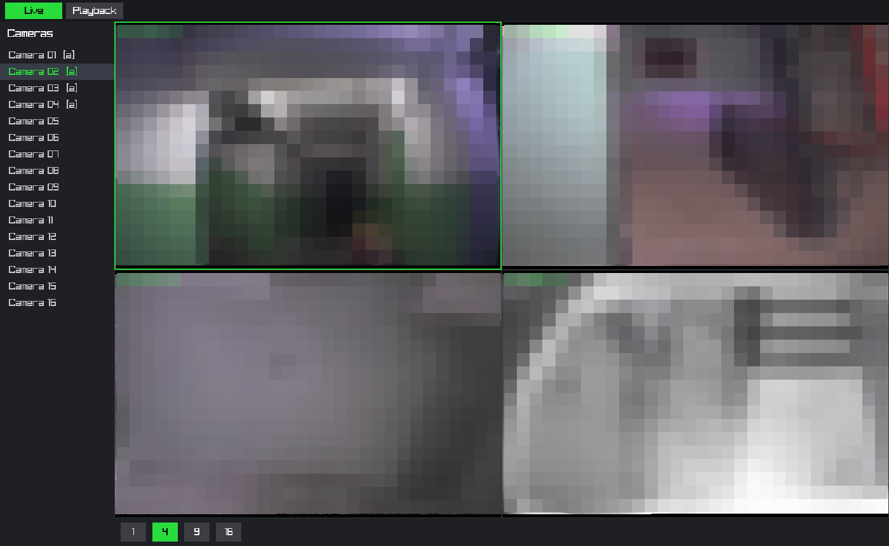
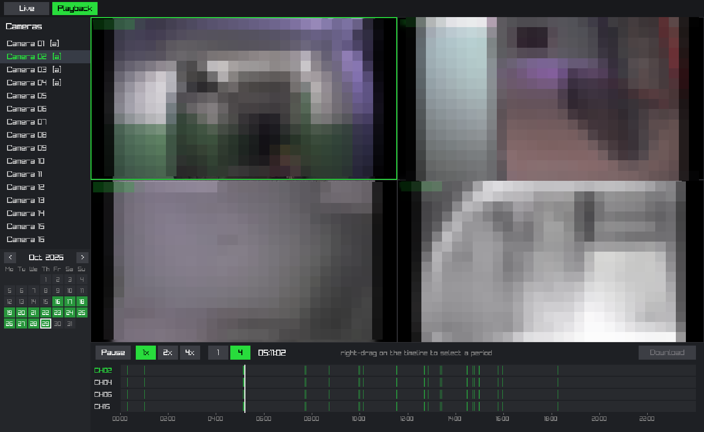

# tvt-dvr-client

An unofficial, native Linux client for network DVRs from the TVT family (the ones that ship the
"EDVR" web client and a Windows CMS). It speaks the device's network protocol itself, so it needs
no proprietary library, renders with [raylib](https://www.raylib.com/) and decodes with FFmpeg.

This project is not affiliated with, endorsed by, or supported by the DVR manufacturer. Product
and company names belong to their owners and are used only to describe compatibility.

## Features

- **Devices**: a list of saved DVRs to pick from, with host, port and user name stored per device.
- **Live view** in 1, 4, 9 or 16 tiles; the 1- and 4-up layouts use the main stream, denser grids
  use the sub stream. Audio of the selected camera.
- **Playback** in 1 or 2x2 tiles (the device allows four playbacks at a time): calendar of
  recorded days, a zoomable 24-hour timeline per channel, pause, 1x/2x/4x speed, click-to-seek.
  Tiles are kept in sync by a master clock.
- **Download** of a selected period into `~/Videos/dvr`: a Matroska file with the H.264 video and
  PCM audio, timestamped from the device clock.

## Screenshots

Live view in the 2x2 layout, four stairwell and hallway cameras:



Playback of four channels at the same moment, with the calendar of recorded days and the
timeline of each channel:



## How it talks to the device

The protocol was reconstructed from network captures and is implemented in `src/proto`; see
[docs/protocol.md](docs/protocol.md). Nothing from the manufacturer is used or included. The
client reaches the device through a small `Device` interface (`src/device`), so the protocol
layer can be replaced or faked in tests.

## Status

Developed and tested against one 16-channel DVR (firmware `3.3.0.P-3531-00`) on Linux/X11. Other
models and firmware may behave differently. See [docs/device-notes.md](docs/device-notes.md) for
what is known about the device behaviour.

Not implemented: PTZ, device configuration, alarm events, reverse playback, automatic reconnect
after a network loss.

## Security

The DVR sends the user name and password in cleartext and does not encrypt the media. Do not
expose its port to the internet; use a VPN or a separate VLAN.

## Requirements

- g++ with C++17, `make`, `pkg-config`
- development packages for raylib, libavformat, libavcodec, libswscale and libavutil

## Build

```sh
make                    # the client and the checks into bin/
make test               # unit tests of the protocol layer and the audio decoder
```

## Run

```sh
./bin/tvt-dvr-client
```

Without arguments the client opens the device screen: pick a saved device or fill in the form for a
new one, then press Connect or Enter. A successful connection saves the device; Delete removes it.
The Devices button in the tab bar returns to the screen to switch devices.

The password is asked on each connection. With "Remember password" ticked it is stored instead,
unencrypted, in `$XDG_CONFIG_HOME/tvt-dvr-client/devices.conf` (`~/.config/tvt-dvr-client/devices.conf`
by default), a file readable only by its owner.

With a host on the command line the client connects at once and skips the screen. Credentials are
then read from the environment so they never appear in the process list or shell history:

```sh
export DVR_USER=... DVR_PASS=...
./bin/tvt-dvr-client <host> [port]                       # port defaults to 6036
```

| Where | Action |
|---|---|
| Camera list | assign the camera to the selected tile (`[a]` marks cameras with audio) |
| Tile | click to select it; audio follows the selected tile; double-click shows the camera alone, double-click again restores the grid |
| Playback calendar | click a day with recordings |
| Timeline | left click seeks; wheel zooms; middle drag pans; right drag selects a period |
| Download button | saves the selected period of the selected camera |
| `F11` | toggle full screen |
| `Esc` | leave full screen, or quit when the window is not full screen |

## AppImage

A self-contained build for x86-64 Linux with glibc 2.28 or newer (Debian 10, Ubuntu 18.10, RHEL 8
and later) is attached to each release:

```sh
chmod +x tvt-dvr-client-*-x86_64.AppImage
./tvt-dvr-client-*-x86_64.AppImage
```

It carries a minimal LGPL build of FFmpeg and a static raylib, so the only things it needs from
the system are the X11 client libraries, OpenGL and a sound server or ALSA. Running it directly
needs FUSE 2; without it, start it with `--appimage-extract-and-run`. Started from a menu entry it
opens the device screen, like the build from source.

Releases are built by a GitHub Actions workflow when a `v*` tag is pushed, see
[docs/releasing.md](docs/releasing.md). To build it yourself (Docker, network access):

```sh
packaging/appimage/build-appimage.sh 0.1.0      # from a clean checkout; writes to dist/
```

The versions of FFmpeg, raylib and the packaging tools are pinned by SHA-256 in
`packaging/appimage/Dockerfile`. The licences of the bundled libraries are in
`packaging/appimage/THIRD-PARTY-NOTICES.md`.

## Checking a device

```sh
./bin/devicecheck <host> /tmp/test.mkv            # searches, live streams, playback, pause, download
./bin/protocheck <host>                           # the protocol layer alone
```

`bin/devicecheck` expects recordings from a particular day of the developer's device and will
need its time constants adjusted for yours.

## Layout

```
src/proto/    the wire protocol: framing, messages, and a logged-in connection
src/device/   the Device interface, its implementation on the protocol, the file writer
src/media/    the audio decoder shared by the player and the file writer
src/client/   the GUI client (stream decoding, playback logic, UI)
src/tools/    command-line checks of a device
tools/        Python programs that use the protocol without the client, and the capture proxy
tests/        unit tests
packaging/    the AppImage build
docs/         the protocol and notes on how the device behaves
```

## License

MIT, see [LICENSE](LICENSE). This applies to the code in this repository only; raylib and FFmpeg
are covered by their own licenses.
